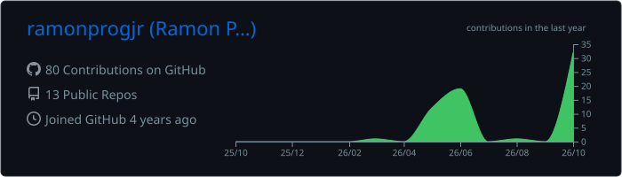

**Desenvolvo produtos de ponta a ponta: do driver no Windows ao app no celular, do CRM no WhatsApp à automação com IA.**

 

  

  

## 🧠 Onde eu uso cada linguagem

| Linguagem | Onde eu uso |
|---|---|
| **Python** | Backends com FastAPI, análise de dados com pandas/NumPy, machine learning com scikit-learn, backtests e agentes de decisão (Desk de Análise de Mercado 🔒, [Dashboard Livance](https://github.com/ramonprogjr/dashboard-livanc)) |
| **TypeScript** | Web apps e CRMs com Next.js + Supabase ([ControlZap](https://github.com/ramonprogjr/controzap), [Escritório Virtual](https://github.com/ramonprogjr/escritorio-virtual)) |
| **C#** | Apps Windows com .NET 8: captura de tela, encoder H.264, injeção de input ([NexScreen](https://github.com/ramonprogjr/Nex-Screen)) |
| **Dart** | Apps Android com Flutter, mapas e OCR no aparelho ([Rota Food](https://github.com/ramonprogjr/Rota-Fast)) |
| **Kotlin** | Android nativo: decodificação de vídeo e toque ([NexScreen](https://github.com/ramonprogjr/Nex-Screen/tree/main/android)) |
| **C++** | Driver de monitor virtual para Windows (IddCx/UMDF) ([NexScreen](https://github.com/ramonprogjr/Nex-Screen/tree/main/driver)) |
| **SQL** | PostgreSQL, Supabase, RLS e funções no banco |

## 🛠️ Ferramentas

  

  
  
  
  
  

## 🚀 Projetos em destaque

<table>
<tr>
<td width="50%" valign="top">

### 🖥️ [NexScreen](https://github.com/ramonprogjr/Nex-Screen)
Transforma um tablet Android num **monitor estendido de verdade** do Windows, por USB ou Wi-Fi.
Driver IddCx, captura por Desktop Duplication, H.264 por hardware e toque como mouse.

`C#` `C++` `Kotlin` `.NET 8`

</td>
<td width="50%" valign="top">

### 💬 [ControlZap](https://github.com/ramonprogjr/controzap)
**CRM headless para WhatsApp**: automação e análise de intenção com IA para quem vende pelo WhatsApp.

`TypeScript` `Next.js` `Supabase` `Mistral AI`

</td>
</tr>
<tr>
<td width="50%" valign="top">

### 🛵 [Rota Food](https://github.com/ramonprogjr/Rota-Fast)
Planejador de rotas para entregadores: OCR de comandas no celular, mapa, sequência sugerida e relatório do turno. Gratuito e sem anúncios.

`Dart` `Flutter` `OpenStreetMap`

</td>
<td width="50%" valign="top">

### 🏢 [Escritório Virtual](https://github.com/ramonprogjr/escritorio-virtual)
Plataforma com CRM, agentes de IA, parceiros e automações de WhatsApp.

`TypeScript` `Next.js` `Supabase` `Claude API`

</td>
</tr>
<tr>
<td colspan="2" valign="top">

### 📈 Desk de Análise de Mercado 🔒 privado
Painel de análise estatística de gráficos de 1 e 5 minutos, movido por um **pipeline de agentes** que roda no fechamento de cada candle. **Por padrão tudo é vetado**: um sinal só passa quando os dados provam vantagem.

**🤖 Pipeline de agentes**

| Agente | Papel |
|---|---|
| 🔭 **Spotter** | Detecta setups: RSI + Bollinger, engolfo, rompimento, pullback na EMA, rejeição de suporte/resistência, pin bar |
| 📚 **Prior** | Taxa de acerto histórica por setup × ativo × expiração × sessão do dia |
| ⚖️ **Edge** | Só aprova se o limite inferior de **Wilson** passar do empate na descoberta (70%) **e** na confirmação (30%) |
| 💰 **Kelly** | Dimensiona a entrada com **¼ de Kelly** sobre o acerto conservador, com teto de 2% da banca |
| 🛑 **Closer** | Gestão de risco: stop diário, limite de entradas, pausa após perdas seguidas, anti-martingale |
| ⚡ **Disjuntor** | Suspende sozinho uma estratégia que piora **ao vivo**, mesmo aprovada pelo histórico |
| 🔁 **Forward** | Resolve todo sinal, aprovado ou vetado, pelo próprio feed: teste ao vivo contínuo |

**🧠 Especialistas e IA:** cinco especialistas (suporte/resistência, tendência, exaustão, price action e contexto) alimentam a **Confluência**, um modelo de machine learning treinado só no passado em walk-forward, com limiar de confiança vindo da validação.

**🧬 Laboratório Evolutivo:** um **algoritmo genético** cria, testa e elimina estratégias sozinho. Os dados são divididos em treino (60%), validação (20%) e um **cofre** (20%) que nunca é visto durante a evolução. Os finalistas passam pelo cofre uma única vez, com correção de **Bonferroni**.

**🔬 Rigor estatístico:** backtest com atraso de execução simulado, walk-forward fora da amostra, comparação com sinal aleatório e intervalos de Wilson em toda decisão.

**🖥️ Painel:** gráfico ao vivo em M1 e M5 com pré-sinal sonoro, zonas de S/R, diário de operações com calibração, alertas no Telegram e coleta de dados por WebSocket com Playwright.

`Python` `FastAPI` `pandas` `NumPy` `scikit-learn` `Playwright` `TypeScript` `React` `Vite` `Lightweight Charts`

</td>
</tr>
</table>

## 📈 Atividade

  

  <picture>
    <source media="(prefers-color-scheme: dark)" srcset="https://raw.githubusercontent.com/ramonprogjr/ramonprogjr/output/github-snake-dark.svg"/>
    <source media="(prefers-color-scheme: light)" srcset="https://raw.githubusercontent.com/ramonprogjr/ramonprogjr/output/github-snake.svg"/>
    
  </picture>

